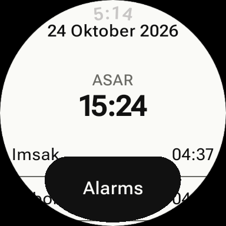

# Brunei Azan

Prayer times and azan alarms for Brunei Darussalam — on your phone, your
Wear OS watch, and Android TV.

Prayer times come from [waktu.co.bn](https://waktu.co.bn), the official schedule
published by Pusat Da'wah Islamiah, Kementerian Hal Ehwal Ugama (Ministry of
Religious Affairs). Covers all four districts: Brunei-Muara, Tutong, Belait and
Temburong.



## Features

**Phone app (`:mobile`)**

- Today's full schedule — Imsak, Suboh, Syuruk, Doha, Zohor, Asar, Maghrib,
  Isyak — with Hijri date and qibla bearing
- Per-prayer alarms (azan sound or beep) plus custom one-off alarms, with
  optional vibration
- District picker, light/dark/system theme, and a paper-style UI with
  selectable font (Sans / Serif / Monospace)

**Watch app (`:wear`)**

- Standalone Wear OS app — fetches prayer times over its own network
- Custom paper-style watch face showing the time and next prayer
- "Next prayer" complication and "Prayer times" tile for any watch face
- Same alarms, settings and swipeable prayer list as the phone

**TV app (`:tv`)**

- Standalone Android TV app — fetches prayer times over its own network
- Full parity with the phone app, rebuilt for the remote: today's schedule,
  per-prayer and custom alarms (azan plays through the TV), district,
  theme and font settings
- D-pad navigation throughout — focusable rows, a wheel-based time picker,
  and a full-screen azan display when an alarm fires

**Settings sync**

When paired, settings sync between phone and watch over the Wearable Data
Layer. When unpaired, each device works on its own. The TV app is fully
standalone — the Data Layer does not exist on Android TV, so its settings
stay on the device.

## Project structure

| Module       | Purpose                                                        |
| ------------ | -------------------------------------------------------------- |
| `:mobile`    | Android phone app (Jetpack Compose)                            |
| `:wear`      | Wear OS app — tile, complication (Compose + Tiles)             |
| `:watchface` | Standalone watch face (Watch Face Format)                      |
| `:tv`        | Android TV app (Compose for TV)                                |
| `:shared`    | Shared library: waktu.co.bn API client, schedule, alarms, settings |

## Tech

Kotlin · Jetpack Compose · Compose for TV · Wear OS Tiles & Watch Face
API · Wearable Data Layer · OkHttp · kotlinx.serialization

- `minSdk` 35, `targetSdk` 37
- No accounts, no analytics, no ads. The only network call is to
  `waktu.co.bn` for prayer times.

## Build

```bash
./gradlew :mobile:assembleDebug   # phone APK
./gradlew :wear:assembleDebug     # watch APK
./gradlew :tv:assembleDebug       # TV APK
./gradlew test                    # unit tests
```

Each form factor uses a `versionCode` offset — wear `10002`, TV `20001` —
because Play requires unique version codes per artifact in one app record.

## Permissions

Notifications, exact alarms, boot receiver and vibration — all in service of
firing azan alarms reliably, including after a reboot. The app never requests
location; the district is chosen manually.

## Links

- Website & privacy policy: https://qoyyuum.anak.it/bruneiazan/
- Prayer times API: https://waktu.co.bn
## Licence

[Apache-2.0](LICENSE). Prayer times come from waktu.co.bn; please check its
terms before redistributing data from it.

### Builds

`mobile` and `wear` have two flavours, both with the same `applicationId`:

| Flavour | versionCode offset | Wearable Data Layer sync | F-Droid |
| ------- | ------------------ | ------------------------ | ------- |
| `gms`   | base               | yes                      | no (proprietary `play-services-wearable`) |
| `foss`  | +100                | no — each device keeps its own settings | yes |

`tv` and `watchface` use only free components and ship one build each.
Settings sync is phone↔watch only; the TV app never synced.
