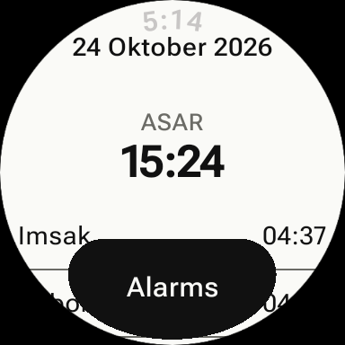

# Brunei Azan

Prayer times and azan alarms for Brunei Darussalam — on your phone and your
Wear OS watch.

Prayer times come from [waktu.co.bn](https://waktu.co.bn), the official schedule
published by Pusat Da'wah Islamiah, Kementerian Hal Ehwal Ugama (Ministry of
Religious Affairs). Covers all four districts: Brunei-Muara, Tutong, Belait and
Temburong.



## Features

**Phone app (`:mobile`)**

- Today's full schedule — Imsak, Suboh, Syuruk, Doha, Zohor, Asar, Maghrib,
  Isyak — with Hijri date and qibla bearing
- Per-prayer alarms (azan sound or beep) plus custom one-off alarms, with
  optional vibration
- District picker, light/dark/system theme, and a paper-style UI with
  selectable font (Sans / Serif / Monospace)

**Watch app (`:wear`)**

- Standalone Wear OS app — fetches prayer times over its own network
- Custom paper-style watch face showing the time and next prayer
- "Next prayer" complication and "Prayer times" tile for any watch face
- Same alarms, settings and swipeable prayer list as the phone

**Settings sync**

When paired, settings sync between phone and watch over the Wearable Data
Layer. When unpaired, each device works on its own.

## Project structure

| Module     | Purpose                                                        |
| ---------- | -------------------------------------------------------------- |
| `:mobile`  | Android phone app (Jetpack Compose)                            |
| `:wear`    | Wear OS app — watch face, tile, complication (Compose + Tiles) |
| `:shared`  | Shared library: waktu.co.bn API client, schedule, alarms, settings |

## Tech

Kotlin · Jetpack Compose · Wear OS Tiles & Watch Face API · Wearable Data
Layer · OkHttp · kotlinx.serialization

- `minSdk` 35, `targetSdk` 37
- No accounts, no analytics, no ads. The only network call is to
  `waktu.co.bn` for prayer times.

## Build

```bash
./gradlew :mobile:assembleDebug   # phone APK
./gradlew :wear:assembleDebug     # watch APK
./gradlew test                    # unit tests
```

The watch module uses `versionCode` offset `10001` — Play requires unique
version codes per APK.

## Permissions

Notifications, exact alarms, boot receiver and vibration — all in service of
firing azan alarms reliably, including after a reboot. The app never requests
location; the district is chosen manually.

## Links

- Website & privacy policy: https://qoyyuum.anak.it/bruneiazan/
- Prayer times API: https://waktu.co.bn
